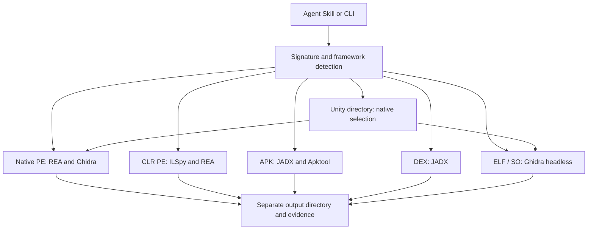

# Architecture

Urimchain is an installation and orchestration layer around existing engines. The source repository contains scripts, a file classifier/router, an Agent Skill and source fixtures. Large third-party distributions are fetched from their publishers at installation time.

The manifest pins dependency identities, source URLs, licenses and direct-download digests. Installation builds relative configuration from the selected root. Java is scoped to tool processes rather than changing system `JAVA_HOME`. REA and ILSpy are installed privately rather than replacing global copies. The optional Codex configuration step backs up its target configuration and installs the independent Skill while preserving unrelated entries.

REA provides CLI and stdio MCP queries; Android support uses its verified JADX bridge and Apktool launcher. CLI engines also remain independently usable. The Skill is an instruction package, not a new MCP server. An agent can combine structured MCP queries with batch CLI output instead of forcing every analysis through one protocol.

Analysis reads targets and writes a separate output tree. Inputs are identified by signatures rather than trusting filename extensions. Native and managed code, resources and container contents may need different engines. Cross-checks should identify concrete agreements or contradictions: Java caller versus Smali invoke, C# versus CIL, pseudocode versus instructions, and a function reference versus its call-site.

Output labels must distinguish actual decompiler text, agent interpretation and unavailable information. Native pseudocode is not original C/C++; IL2CPP native output is not reconstructed C#. Debug names, comments, exact types and original project layout may be missing.
